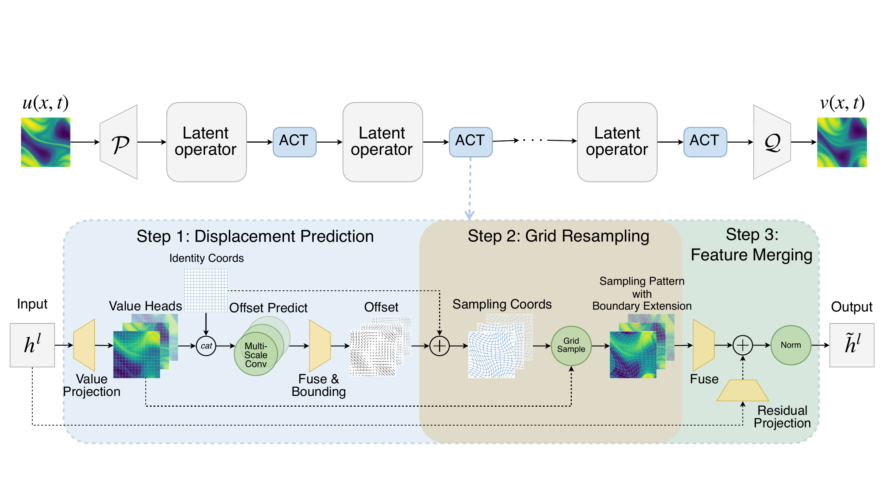

# Adaptive Coordinate Transforms for Neural Operators

The Well-based training code for Adaptive Coordinate Transforms (ACT) neural operators.

## Workflow



## Setup

Create or activate the conda environment:

```bash
conda env create -f thewell_environment.yml
conda activate thewell
```

If the environment already exists:

```bash
conda activate thewell
```

## Data

Data preparation and dataset format follow The Well. Please refer to the official The Well documentation for downloading and organizing datasets.

## Train

ACT-FNO:

```bash
CONDA_NO_PLUGINS=true conda run -n thewell python benchmark/train.py experiment=act_fno server=local
```

ACT-FNO 3D:

```bash
CONDA_NO_PLUGINS=true conda run -n thewell python benchmark/train.py experiment=act_fno_3d server=local
```

ACT ConvNeXt:

```bash
CONDA_NO_PLUGINS=true conda run -n thewell python benchmark/train.py experiment=act_convnext server=local
```

ACT Transolver:

```bash
CONDA_NO_PLUGINS=true conda run -n thewell python benchmark/train.py experiment=act_transolver server=local
```

Vanilla baseline:

```bash
CONDA_NO_PLUGINS=true conda run -n thewell python benchmark/train.py experiment=vanilla_fno server=local
```


Print config only:

```bash
CONDA_NO_PLUGINS=true conda run -n thewell python benchmark/train.py experiment=act_fno server=local --cfg job
```

## Slurm Example

```bash

source /opt/software/anaconda3/etc/profile.d/conda.sh
conda activate thewell

export OMP_NUM_THREADS=${SLURM_CPUS_ON_NODE}
export WANDB_MODE=offline

srun python benchmark/train.py experiment=act_fno server=rusty data.batch_size=64 optimizer.lr=1e-4
```

## Outputs

Training writes experiment folders under `experiments/` by default. Hydra logs are written under `outputs/`.

## Acknowledgements

This project is developed from The Well. We thank The Well authors and contributors for the dataset format, benchmark structure, training pipeline, and evaluation utilities.
